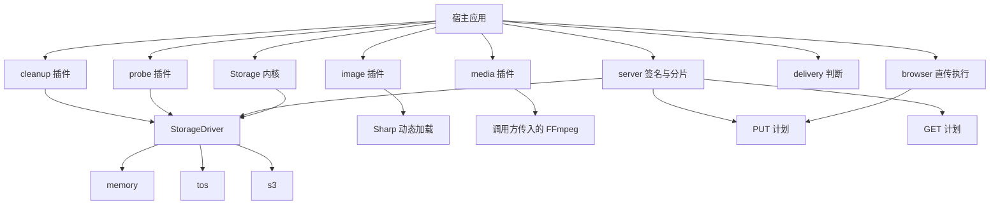
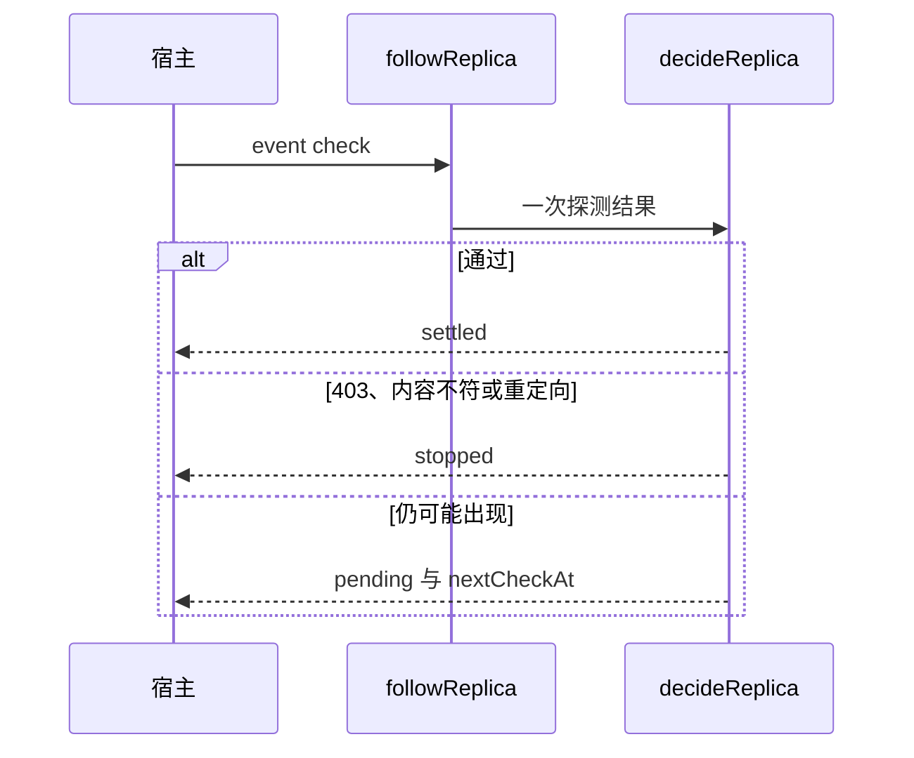

# object-storage

三个应用共用的对象存储包。上传、处理、探测和交付判断是四件独立的事：处理成功不表示已经上传，上传成功不表示链接已验证，判断够用也不表示已经处理。

当前版本 `0.0.0`，`private`，还没有发布到 npm。真实桶密钥只从运行环境读取，不放进仓库。更完整的时序图见 [docs/architecture.md](docs/architecture.md)。

## 架构

根入口只导出存储内核。图片、音视频、探测、清理、交付判断和云驱动都是旁边的模块，调用方按需导入。包里没有流水线，宿主自己串联。



副本是否就绪不在包里长轮询。宿主发出 `check` 或 `timeout`，`followReplica` 做一次判断后就可以退出。



`assessDelivery` 只比较已有事实和调用方约束。够用返回 `usable`。图片、视频、音频分别指出一个现有函数。其他类型返回 `unsupported`。缺事实时不猜。

## 目录

```text
src/
  index.ts                 根入口：Storage、错误、输入输出
  core/                    契约、配置、封存与上传
  io/                      字节读取、校验和、临时产物
  browser/                 只执行已签名的 PUT
  server/                  PUT、GET 与分片计划
  delivery/                交付约束判断
  drivers/
    memory.ts              契约用内存驱动
    tos.ts                 火山 TOS
    s3.ts                  S3 兼容接口
  plugins/
    probe/                 桶、对象、URL、事件等待
    cleanup/               登记对象和分片
    image/                 Sharp 转换、缩放、目标体积
    media/                 FFmpeg 转码、压缩、裁剪、拼接
examples/
  server-archive.ts        内存驱动上传并封存
  calls.ts                 交付判断和 GET 计划
tests/
  unit/                    行为测试
  contracts/               TOS 与 S3 的注入客户端契约
  integration/             本地 FFmpeg，以及可选的真实桶
  package/                 构建产物和入口隔离
docs/architecture.md
```

## 入口

| 导入 | 用途 |
| --- | --- |
| `object-storage` | 上传、封存、读取、临时产物 |
| `object-storage/browser` | 浏览器执行 PUT |
| `object-storage/server` | PUT、GET、分片计划 |
| `object-storage/delivery` | `assessDelivery` |
| `object-storage/drivers/memory` | 内存驱动 |
| `object-storage/drivers/tos` | TOS 驱动 |
| `object-storage/drivers/s3` | S3 驱动 |
| `object-storage/plugins/probe` | 探测 |
| `object-storage/plugins/cleanup` | 清理 |
| `object-storage/plugins/image` | 图片 |
| `object-storage/plugins/media` | 音视频 |

`src/index.ts` 不导入 Sharp、FFmpeg 或云 SDK。浏览器入口不包含 Node 内置模块和云凭证。

## 功能

- 服务端上传、条件封存、读取。`delivery.status` 固定是 `not_requested`。
- ETag 和 checksum 分开。CRC64 保持字符串。没有 SHA-256 时，封存在调用方给出的字节预算内读正文再比对。
- 浏览器执行已签名的 PUT。服务端签发 PUT 和 GET。TOS 预签名没有 HEAD，要 HEAD 时直接拒绝。
- 分片计划按调用方的分片大小计算，不填默认分片。
- 探测桶、对象和 URL。同大小不同内容不算通过。GET 签名不能拿去发 HEAD。
- 副本等待由宿主事件推进，包内不睡眠。
- 清理只删除登记对象，核对 `storageId`，一次失败继续处理后面的项，只终止登记的分片。
- 图片转换、缩放、目标体积。透明转 JPEG 和动画策略由调用方决定。
- 音视频转码、压缩、提取、裁剪、拼接。路径、码率和分辨率由调用方传入，不用截断凑体积。
- `assessDelivery` 指出该调用哪个现有函数，不填处理参数。

## 调用示例

内存驱动上传并封存，见 [examples/server-archive.ts](examples/server-archive.ts)。

```ts
import { createStorage } from 'object-storage';
import { createMemoryDriver } from 'object-storage/drivers/memory';

const storage = createStorage({
  drivers: [createMemoryDriver({ storageId: 'local' })],
});

const uploaded = await storage.upload({
  storageId: 'local',
  key: 'temp/note.txt',
  contentType: 'text/plain',
  source: { kind: 'bytes', data: new TextEncoder().encode('abc') },
});

if (!uploaded.checksum) throw new Error('upload did not return a checksum');

const sealed = await storage.finalize({
  storageId: 'local',
  tempKey: uploaded.object.key,
  finalKey: 'final/note.txt',
  expectedChecksum: uploaded.checksum,
});
```

交付判断和 GET 计划的调用形状见 [examples/calls.ts](examples/calls.ts)。判断结果可能是 `usable`、`adapt`、`insufficient_evidence` 或 `unsupported`。GET 计划的 `url` 含签名，不要写进日志。

```ts
import { assessDelivery } from 'object-storage/delivery';
import { createSingleGetPlan } from 'object-storage/server';

const fit = assessDelivery(
  { mediaType: 'image/png', byteLength: 120_000, width: 1600, height: 900 },
  { allowedMediaTypes: ['image/webp'], maxBytes: 80_000, maxEdge: 1280 },
);

const plan = await createSingleGetPlan(driver, {
  object: { storageId: 'live', key: 'final/note.txt' },
  expiresInSeconds: 60,
});
```

`fit.status === 'adapt'` 时，`fit.operation` 是 `convertImage`、`resizeImage`、`compressImage`、`transcodeVideo`、`compressVideo`、`trimMedia` 或 `transcodeAudio` 之一。参数仍由调用方传入。

## 开发

要求 Node.js 22 或更新版本。安装和测试使用 npm。

```sh
npm install
npm test
npm run typecheck
npm run build
npm run test:package
```

`npm run test:integration` 在没有 `OBJECT_STORAGE_LIVE_TEST=1` 时失败退出。配置了 `OBJECT_STORAGE_S3_BUCKET`、`OBJECT_STORAGE_S3_REGION`、`OBJECT_STORAGE_S3_ENDPOINT`、`OBJECT_STORAGE_S3_ACCESS_KEY_ID` 和 `OBJECT_STORAGE_S3_SECRET_ACCESS_KEY` 之后，它只对 `object-storage-smoke/` 前缀做一次上传、签名、检查和删除。

## 不做的事

包不保存云凭证，不改桶规则，不建数据库、队列或常驻轮询。不自动把一个地区的对象拉到另一个地区。不内置某种地区默认格式。npm 发布和镜像到组织仓库另行决定。
