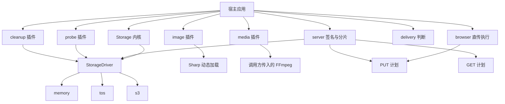
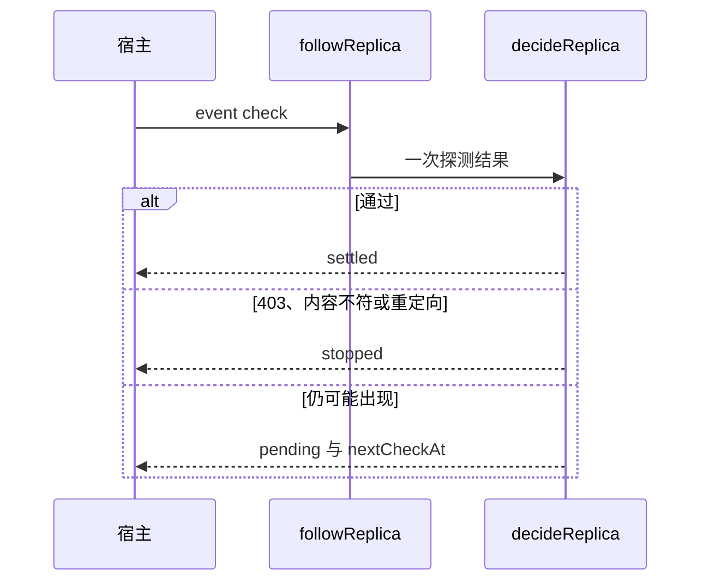

# @byte_fluffy/object-storage

三个应用共用的对象存储包。上传、处理、探测和交付判断是四件独立的事：处理成功不表示已经上传，上传成功不表示链接已验证，判断够用也不表示已经处理。

当前版本 `0.1.2`，个人 npm scope 为 `@byte_fluffy`。真实桶密钥只从运行环境读取，不放进仓库。更完整的时序图见 [docs/architecture.md](docs/architecture.md)。

## 架构

根入口只导出存储内核。图片、音视频、探测、清理、交付判断和云驱动都是旁边的模块，调用方按需导入。包里没有流水线，宿主自己串联。



副本是否就绪不在包里长轮询。宿主发出 `check` 或 `timeout`，`followReplica` 做一次判断后就可以退出。



`assessDelivery` 只比较已有事实和调用方约束。够用返回 `usable`。图片、视频、音频分别指出一个现有函数。其他类型返回 `unsupported`。缺事实时不猜。

## 目录

```text
src/
  index.ts                 根入口：Storage、错误、输入输出
  core/                    契约、配置、封存与上传
  io/                      字节读取、校验和、临时产物
  browser/                 只执行已签名的 PUT
  server/                  PUT、GET 与分片计划
  delivery/                交付约束判断
  drivers/
    memory.ts              契约用内存驱动
    tos.ts                 火山 TOS
    s3.ts                  S3 兼容接口
  plugins/
    probe/                 桶、对象、URL、事件等待
    cleanup/               登记对象和分片
    image/                 Sharp 转换、缩放、目标体积
    media/                 FFmpeg 转码、压缩、裁剪、拼接
examples/
  server-archive.ts        内存驱动上传并封存
  calls.ts                 交付判断和 GET 计划
tests/
  unit/                    行为测试
  contracts/               TOS 与 S3 的注入客户端契约
  integration/             本地 FFmpeg，以及可选的真实桶
  package/                 构建产物和入口隔离
docs/architecture.md
```

## 入口

| 导入 | 用途 |
| --- | --- |
| `@byte_fluffy/object-storage` | 上传、封存、读取、临时产物 |
| `@byte_fluffy/object-storage/browser` | 浏览器执行 PUT |
| `@byte_fluffy/object-storage/server` | PUT、GET、分片计划 |
| `@byte_fluffy/object-storage/delivery` | `assessDelivery` |
| `@byte_fluffy/object-storage/drivers/memory` | 内存驱动 |
| `@byte_fluffy/object-storage/drivers/tos` | TOS 驱动 |
| `@byte_fluffy/object-storage/drivers/s3` | S3 驱动 |
| `@byte_fluffy/object-storage/plugins/probe` | 探测 |
| `@byte_fluffy/object-storage/plugins/cleanup` | 清理 |
| `@byte_fluffy/object-storage/plugins/image` | 图片 |
| `@byte_fluffy/object-storage/plugins/media` | 音视频 |

`src/index.ts` 不导入 Sharp、FFmpeg 或云 SDK。浏览器入口不包含 Node 内置模块和云凭证。

## 功能

- 服务端上传、条件封存、读取。`delivery.status` 固定是 `not_requested`。
- ETag 和 checksum 分开。CRC64 保持字符串。没有 SHA-256 时，封存在调用方给出的字节预算内读正文再比对。
- 浏览器执行已签名的 PUT。服务端签发 PUT 和 GET。TOS 预签名没有 HEAD，要 HEAD 时直接拒绝。
- 分片计划按调用方的分片大小计算，不填默认分片。
- 探测桶、对象和 URL。同大小不同内容不算通过。GET 签名不能拿去发 HEAD。
- 副本等待由宿主事件推进，包内不睡眠。
- 清理只删除登记对象，核对 `storageId`，一次失败继续处理后面的项，只终止登记的分片。
- 图片转换、缩放、目标体积。透明转 JPEG 和动画策略由调用方决定。
- 音视频转码、压缩、提取、裁剪、拼接。路径、码率和分辨率由调用方传入，不用截断凑体积。
- `assessDelivery` 指出该调用哪个现有函数，不填处理参数。

## 安装

```sh
npm install @byte_fluffy/object-storage
```

S3、TOS 按需安装对应的可选 peer dependency：`@aws-sdk/client-s3` 与 `@aws-sdk/s3-request-presigner`、`@volcengine/tos-sdk`。图片插件的 Sharp 依赖由本包安装和维护，调用方无需直接安装。FFmpeg 由宿主提供。

### Bundled server applications

Image processing stays behind `@byte_fluffy/object-storage/plugins/image`. Metadata reports display dimensions after EXIF orientation, and conversion applies that orientation before removing metadata. Originals are never modified.

For esbuild applications that deploy a standalone output directory, use the package's build plugin:

```js
import { build } from 'esbuild';
import { objectStorageImagePlugin } from '@byte_fluffy/object-storage/build/esbuild';

await build({
  entryPoints: ['src/main.ts'],
  bundle: true,
  platform: 'node',
  format: 'esm',
  outfile: 'dist/main.mjs',
  plugins: [objectStorageImagePlugin()],
});
```

Deploy the entire `dist` directory, including its generated `node_modules`. The plugin keeps native binaries outside the JavaScript bundle and copies the image engine's installed runtime dependencies. Build on the same operating system and architecture as the deployment target. The build helper requires esbuild `^0.28.0`; normal runtime imports do not load it.

### Bounded server uploads

`Storage.upload` consumes bytes, files and streams through the same upload path.
Files are read as streams. SHA-256 is calculated incrementally, and progress is
reported only after a successful PUT or part receipt. The callback may return a
promise; the uploader awaits it before reading further.

```ts
const uploaded = await storage.upload({
  storageId: 'media',
  key: 'video/generated.mp4',
  source: { kind: 'stream', stream: response.body },
  contentType: 'video/mp4',
  multipartOptions: {
    thresholdBytes: 30 * 1024 * 1024,
    partSizeBytes: 16 * 1024 * 1024,
  },
  signal,
  onProgress: uploadedBytes => reportProgress(uploadedBytes),
});
```

Both values are byte counts. The defaults are a 30 MiB multipart threshold and
16 MiB parts. Reaching the threshold enables multipart; `multipart: 'required'`
starts a multipart session regardless of length. Part size must satisfy the
selected driver's limits. Unknown-length input is supported; no total length is
invented for the multipart session.

Known large inputs need one part buffer. Unknown-length input needs at most
`max(thresholdBytes, partSizeBytes)` of staging payload, plus the current source
chunk. Part/ETag metadata grows with the number of parts. This is not a fixed
process-memory guarantee. A producer that enqueues a whole file in one chunk has
already allocated that chunk outside the uploader.

Declared length, maximum input size and expected SHA-256 are checked before
multipart completion. Failure or cancellation cancels the source and aborts an
admitted session without replacing the original error. Admission and cleanup
use independent ten-second signals, so an already-cancelled caller signal does
not prevent session reclamation. The caller still owns and releases its cloud
client.

S3-compatible drivers forward AbortSignal to in-flight SDK requests. Native TOS
SDK 2.9.1 does not expose per-request cancellation on its low-level multipart
methods. That adapter checks cancellation before calls and preserves a late
creation receipt for cleanup, but cannot promise physical interruption or a
ten-second hard deadline for an in-flight native TOS request. Applications that
need these guarantees can use their TOS service's S3-compatible endpoint.

### Public URL availability

Use the existing probe with explicit verification semantics:

```ts
const result = await checkUrl({
  url: 'https://media.example/video/generated.mp4',
  method: 'HEAD',
  signatureMethod: 'unsigned',
  verification: 'availability',
  fetch,
  signal,
});
```

`passed` in availability mode establishes HTTP accessibility only, with the
actual `httpStatus` and available response metadata. It supplies no content
checksum. The default checksum mode still reads and verifies content; HEAD is
not checksum evidence. Availability cannot be combined with expectedChecksum,
and unsigned URLs cannot contain a query string. Signed HEAD remains bound to
a HEAD signature. Hosts retain retry scheduling through the existing event
interface; the package adds no polling loop.

## 调用示例

内存驱动上传并封存，见 [examples/server-archive.ts](examples/server-archive.ts)。

```ts
import { createStorage } from '@byte_fluffy/object-storage';
import { createMemoryDriver } from '@byte_fluffy/object-storage/drivers/memory';

const storage = createStorage({
  drivers: [createMemoryDriver({ storageId: 'local' })],
});

const uploaded = await storage.upload({
  storageId: 'local',
  key: 'temp/note.txt',
  contentType: 'text/plain',
  source: { kind: 'bytes', data: new TextEncoder().encode('abc') },
});

if (!uploaded.checksum) throw new Error('upload did not return a checksum');

const sealed = await storage.finalize({
  storageId: 'local',
  tempKey: uploaded.object.key,
  finalKey: 'final/note.txt',
  expectedChecksum: uploaded.checksum,
});
```

交付判断和 GET 计划的调用形状见 [examples/calls.ts](examples/calls.ts)。判断结果可能是 `usable`、`adapt`、`insufficient_evidence` 或 `unsupported`。GET 计划的 `url` 含签名，不要写进日志。

```ts
import { assessDelivery } from '@byte_fluffy/object-storage/delivery';
import { createSingleGetPlan } from '@byte_fluffy/object-storage/server';

const fit = assessDelivery(
  { mediaType: 'image/png', byteLength: 120_000, width: 1600, height: 900 },
  { allowedMediaTypes: ['image/webp'], maxBytes: 80_000, maxEdge: 1280 },
);

const plan = await createSingleGetPlan(driver, {
  object: { storageId: 'live', key: 'final/note.txt' },
  expiresInSeconds: 60,
});
```

`fit.status === 'adapt'` 时，`fit.operation` 是 `convertImage`、`resizeImage`、`compressImage`、`transcodeVideo`、`compressVideo`、`trimMedia` 或 `transcodeAudio` 之一。参数仍由调用方传入。

## 开发

要求 Node.js 22 或更新版本。安装和测试使用 npm。

```sh
npm install
npm test
npm run typecheck
npm run build
npm run test:package
```

`npm run test:integration` 在没有 `OBJECT_STORAGE_LIVE_TEST=1` 时失败退出。配置了 `OBJECT_STORAGE_S3_BUCKET`、`OBJECT_STORAGE_S3_REGION`、`OBJECT_STORAGE_S3_ENDPOINT`、`OBJECT_STORAGE_S3_ACCESS_KEY_ID` 和 `OBJECT_STORAGE_S3_SECRET_ACCESS_KEY` 之后，它只对 `@byte_fluffy/object-storage-smoke/` 前缀做一次上传、签名、检查和删除。

## 不做的事

包不保存云凭证，不改桶规则，不建数据库、队列或常驻轮询。不自动把一个地区的对象拉到另一个地区。不内置某种地区默认格式。迁移到组织 scope 另行决定。
