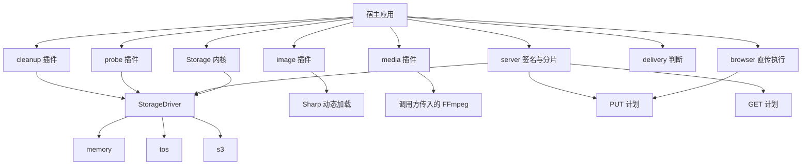
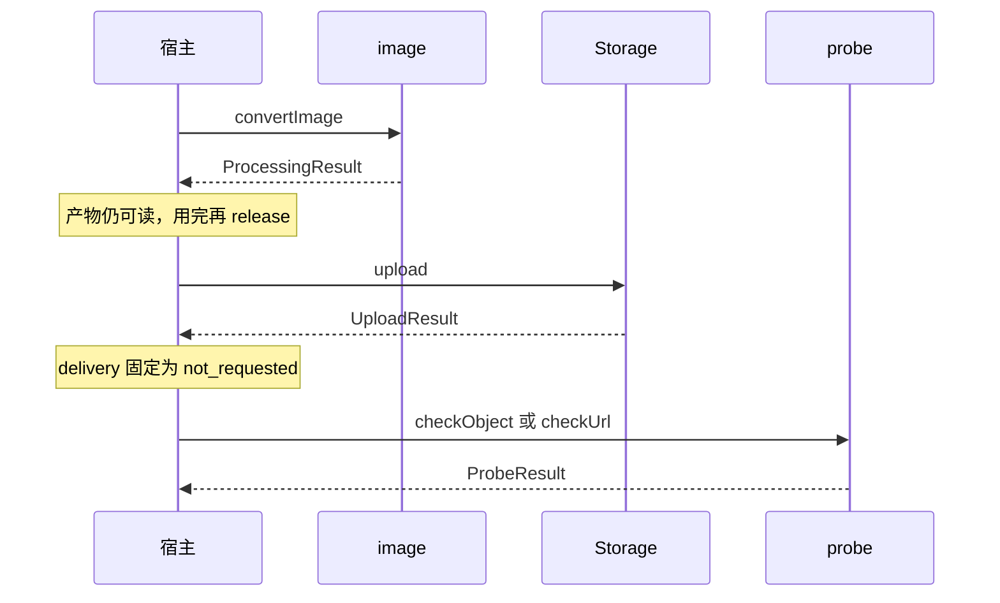
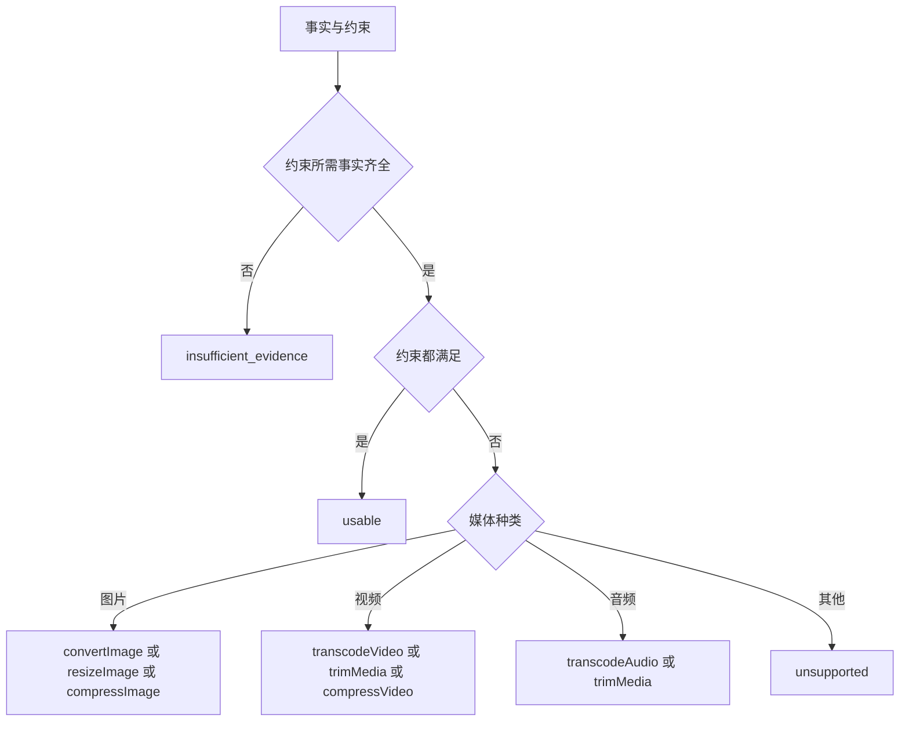
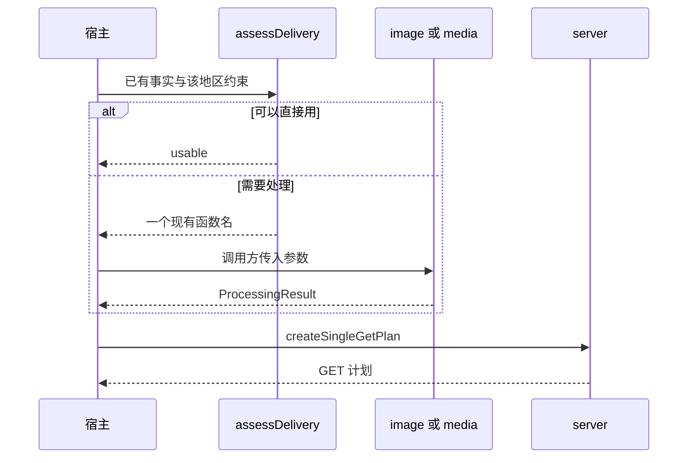
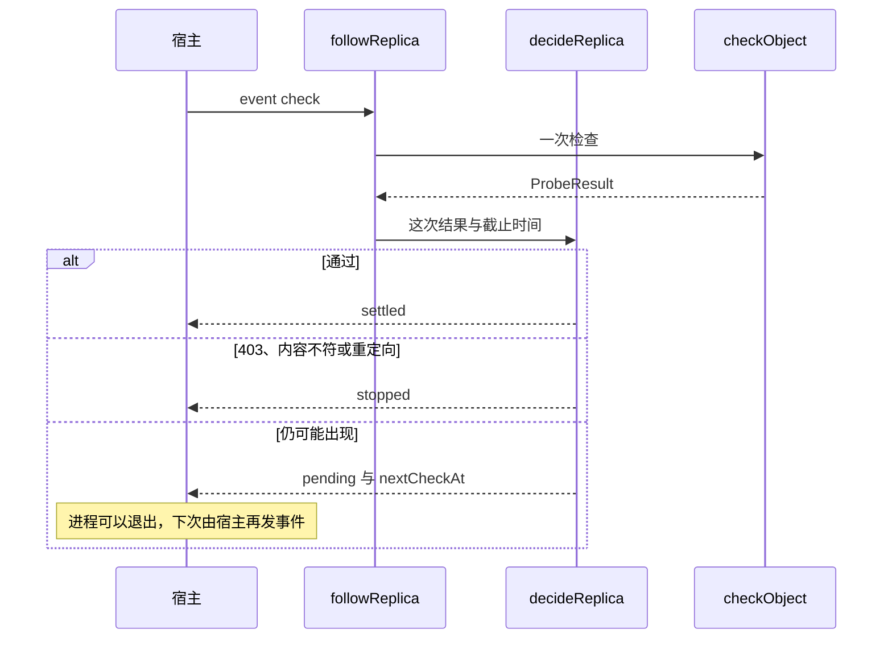

# 架构

这个包把上传、处理、探测和交付判断分成独立结果。处理成功不表示已经上传，上传成功不表示链接已验证，判断够用也不表示已经处理。根入口只导出存储内核。图片、音视频、探测、清理、交付判断、TOS 和 S3 都是旁边的模块，调用方按需导入。

## 模块

内核文件在 `src/core`、`src/io`。`src/index.ts` 不导入 Sharp、FFmpeg 或云 SDK。浏览器入口只执行已经签好的 PUT 计划，不保存云凭证。`createSingleGetPlan` 只生成 GET，过期秒数由调用方传入。

## 一次调用只做一件事

宿主自己串联。包里没有流水线。

服务端封存走 `Storage.finalize`：先核对临时对象的 SHA-256，再用 `ifNoneMatch: '*'` 复制到最终 Key。内容不一致不会覆盖已有对象。临时对象不会被这次调用删除。

## 交付判断不处理文件

`assessDelivery` 只比较已经拿到的事实和调用方约束。事实来自探测或图片、音视频元信息。约束包括允许的媒体类型、最大字节、最大边和最大时长。它不读取文件，也不填处理参数。

多种约束同时不满足时，只返回第一个该处理的函数，并列出其余失败项。宿主处理完再判断一次。图片没有边长或时长这类事实时，不会把缺数据当成失败。

地区差异留在宿主传入的约束里。包不知道北京或柔佛该用哪种格式。

## 副本等待是事件，不是长轮询

`followReplica` 不睡眠，也不保住一条轮询。宿主从自己的队列或桶通知发出 `check` 或 `timeout`。`decideReplica` 只根据这一次结果作决定。

通过就结束。权限失败、内容不符和重定向不再排下一次检查。只有对象还可能出现时，才把 `nextCheckAt` 交回宿主。

## 驱动

TOS 和 S3 都实现同一个 `StorageDriver`。厂商类型停在驱动文件里。条件写在 TOS 上使用已核对的 `forbidOverwrite`，在 S3 3.1007.0 上使用 `IfNoneMatch`。CRC64 保持字符串。ETag 不写入 checksum。PUT 和 GET 是两份计划。TOS SDK 的预签名没有 HEAD，所以要 HEAD 时直接拒绝。
